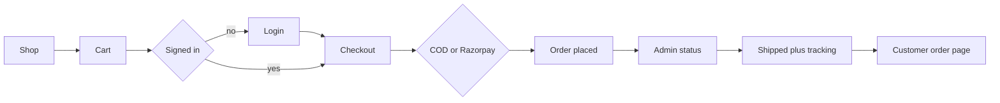
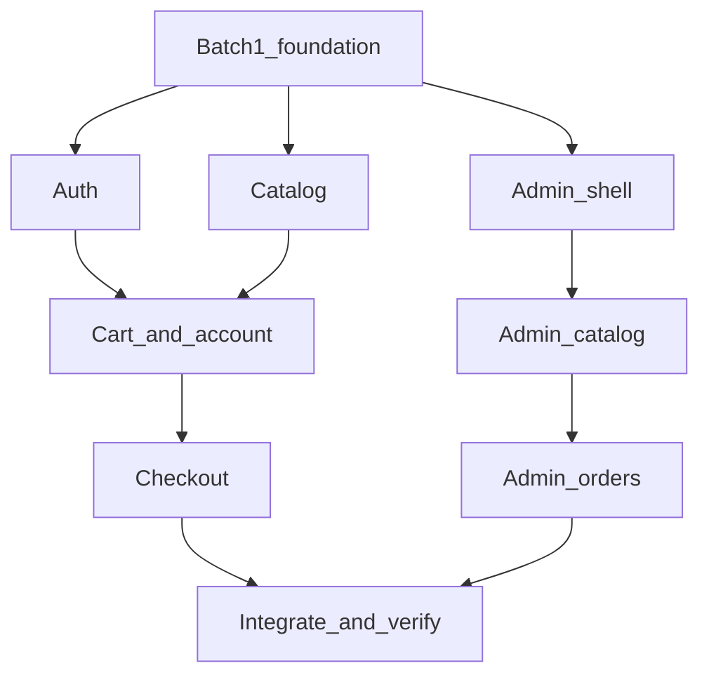

# Fashion storefront and admin

One Next.js (App Router) app in the empty [demo-project-ecom](/Users/apple/francisworks/demos/tutor-video/demo-project-ecom) folder: storefront, API routes, and `/admin`.

## Database

SQLite only, through Prisma. The file is `prisma/dev.db`, the datasource provider is `sqlite`, and `DATABASE_URL` is `file:./dev.db`. No Postgres, MySQL, or hosted database. Batch 1 creates the schema, runs the migration, and seeds that file. Later batches only read and write through the shared Prisma client.

## Stack and look

- Next.js, TypeScript, Tailwind, Prisma, SQLite, bcrypt sessions in an httpOnly cookie.
- One typeface for both surfaces: **Plus Jakarta Sans**. Prices stay in INR. The reference screens show dollars; copy and currency follow the India checkout (GST, COD, Razorpay), while layout, color, and components follow the two images.
- Reference files to attach on every UI agent: [storefront](/Users/apple/.cursor/projects/Users-apple-francisworks-demos-tutor-video-demo-project-ecom/assets/image-6bb80738-242c-47eb-9173-74749cd27f29.png) and [admin](/Users/apple/.cursor/projects/Users-apple-francisworks-demos-tutor-video-demo-project-ecom/assets/image-fcf96d8b-bc1d-4d11-be07-d9027b10cb7c.png).
- Product photos from Unsplash URLs (seeded). Admin product images are URL fields so adding a product does not need file storage.
- Apparel GST defaults to 5% at or under ₹1,000 and 12% above, overridable in settings.

### Storefront (image 1)

The shop is a white rounded panel with a thick black border, sitting on a pink canvas (`#ffd1ea`). Inside the panel:

- Header: bold black **wearism** wordmark, a wide pill search (“Search for items, brands and inspiration”), wishlist heart, cart count in a black circle, locale label.
- Pink promo banner with a short illustrated sale treatment (flat sticker-style graphics, not stock photos): offer line, code, black pill button.
- Left rail: Home, **New in** as a purple pill with a lightning icon, then Coats, Tops, Knitwear, each with a small photo thumbnail.
- Main column: category title, “View more”, pill filters (Sort, Product type, Style, Size, Colour, Price range), then a horizontal row of portrait cards. Each card is a light-gray rounded photo with a white heart button. No heavy shadows.

Product, cart, auth, checkout, and account pages stay inside the same pink canvas and white panel so they feel like the same site. Purple (`#b9a3f5`) is the only accent, used for the active category.

### Admin (image 2)

Light gray app background, white sidebar, orange accent (`#ff7a3d`). Brand mark is an orange rounded icon plus the word **Wearism**, in the same chrome as the Salesai reference (do not use a second brand name).

- Top bar: search, a small command hint, message and notification icons, circular avatar, admin name, store name.
- Sidebar groups: **Menu** (Dashboard, Orders with an orange count badge, Customers) and **Tools** (Products with a peach active state, Analytics, GST invoice). **Settings** sits at the bottom. Skip Message, Integrations, Discount, Security, and Help; those are not part of this app.
- Products page: toolbar with list/grid toggle, search, show and sort menus, outline Filter, orange **Add new product**. Second row of pill filters: category, price, status (All / Active / Inactive), collection. Table columns: checkbox, thumbnail plus name and SKU, price, units, a stock bar (green when healthy, orange when low), active toggle.
- Dashboard, orders, customers, GST, and settings reuse this sidebar, top bar, peach active state, and orange primary buttons.

## Data

- **User**: name, email, phone, password hash, role (`customer` | `admin`).
- **Address**, **PasswordResetToken**.
- **Category**, **Product** (slug, SKU, description, price, MRP, stock, active flag, sizes, colors, image URLs, category), **Review**.
- **Cart** / **CartItem** (server cart for the signed-in user; guest cart in a cookie until login, then merged).
- **Order** / **OrderItem**: status `placed` → `processing` → `shipped` → `delivered`, payment method `cod` | `razorpay`, payment status, GST snapshot per line.
- **Shipment**: carrier, tracking number, event list. Written when status becomes `shipped`; visible on the customer order page.
- **StoreSetting**: store name, GST bands, support email.

Seed an admin (`admin@wearism.dev` / `admin12345`), a customer, and about 12 products in **New in, Coats, Tops, and Knitwear**, plus a couple of sample orders. Each product has a SKU, an active flag, and stock used by the admin progress bar.

## Storefront

- **Home and shop** (`/` and `/shop`): the image 1 layout. `/` opens on New in. The left rail switches category. Search, sort, and the pill filters (type, style, size, colour, price) narrow the row. Heart toggles a wishlist; the card click opens the product. Add to cart lives on the product page and on hover of the card.
- **Product** (`/product/[slug]`): gallery, description, size, stock, reviews, related products from the same category, add to cart. Same pink canvas and white panel.
- **Cart** and **account**: orders list, order detail with status timeline and tracking, saved addresses. Profile holds name, email, phone.
- **Auth**: register, login, forgot password. Forgot password creates a token and shows the reset URL on the page (demo, no inbox). Checkout and account require a session; guests hitting checkout go to login and return.

## Checkout and payments

- Address step (saved or new), order summary with GST, then COD or online.
- **Razorpay**: if `RAZORPAY_KEY_ID` and `RAZORPAY_KEY_SECRET` are set, create an order and open Checkout. On success, verify the signature server-side and mark the order paid.
- **No keys**: the online option is labeled as a demo payment and marks the order paid without calling Razorpay. COD always works and stays `pending` until the admin marks it collected or the order is delivered.
- Success page, then a status page with the same timeline the admin updates.

## Admin (`/admin`, admin role only)

- **Dashboard**: same shell as image 2. Revenue, order counts by status, low stock, a simple revenue-by-day chart.
- **Products**: the image 2 table (search, filters, stock bar, active toggle) plus create and edit. Name, SKU, pricing, MRP, stock, category, sizes, colors, image URLs, description, active flag.
- **Orders**: list and detail. Move status along placed → processing → shipped → delivered. Shipping requires carrier and tracking number; those fields show on the customer order page.
- **Customers**: name, email, phone, addresses, order count.
- **GST report**: date range, taxable value, GST, invoice-style rows per order.
- **Settings**: store name, GST thresholds, Razorpay key presence (keys stay in env, not in the database).

## Build in batches with Cursor multitask

Implementation uses local `generalPurpose` agents through the Task tool. Each batch is one message that starts every agent in that batch together with `run_in_background: true` (Multitask Mode). The parent waits until that batch finishes, checks the files, then starts the next batch. Agents stay on this working tree. Cloud agents and separate worktrees are not used, because the app shares one schema and one design system.

Each agent gets a written prompt with the stack, visual rules, seed logins, and the folders it may edit. It must not touch another agent’s folders in the same batch.

### Batch 1 — foundation (one agent)

Nothing else can start until this exists.

- Next.js App Router, TypeScript, Tailwind, Prisma, SQLite, Plus Jakarta Sans, `.env.example`.
- Full Prisma schema and seed (admin `admin@wearism.dev` / `admin12345`, one customer, categories New in / Coats / Tops / Knitwear, ~12 products with SKU and active flag, reviews, two sample orders).
- Shared pieces other agents import and do not rewrite: `lib/prisma.ts`, `lib/format.ts`, `lib/gst.ts`, design tokens for the pink storefront shell and the orange admin shell, root layout. Attach both reference images.
- Empty route groups `(store)`, `(auth)`, `(account)`, `(admin)` so later agents add pages without editing `app/layout.tsx`.

### Batch 2 — three agents in parallel

- **Auth** owns `app/(auth)`, `lib/auth.ts`, `middleware.ts`: register, login, logout, forgot-password demo link, httpOnly session, role check.
- **Catalog** owns `app/(store)` home, `/shop`, `/product/[slug]`: image 1 shell, left category rail, promo banner, pill filters, portrait cards, reviews, related products. Add to cart calls a stub `lib/cart.ts` interface the next batch implements. Attach the storefront reference image.
- **Admin shell** owns `app/(admin)/layout.tsx` and `/admin` dashboard: image 2 sidebar, top bar, orange accent, revenue, orders by status, low stock, revenue-by-day chart. Reads the database only. Attach the admin reference image.

### Batch 3 — two agents in parallel

- **Cart and account** owns `lib/cart.ts`, cart page, `/account` profile, orders list (read-only status), addresses. Guest cookie cart merges on login.
- **Admin catalog** owns `/admin/products`, `/admin/customers`, `/admin/settings`: image 2 product table (filters, stock bar, active toggle) and create/edit (price, MRP, stock, images, sizes, colors, category, SKU), customer email and phone, store name and GST bands. Attach the admin reference image.

### Batch 4 — two agents in parallel

- **Checkout** owns `/checkout`, `/order/[id]`, `app/api/checkout` and `app/api/razorpay`: auth gate, GST summary, COD, Razorpay when env keys exist, simulated online pay otherwise, confirmation and status timeline.
- **Admin orders** owns `/admin/orders` and `/admin/reports/gst`: status `placed` → `processing` → `shipped` → `delivered`, carrier and tracking number required to ship, GST report by date. Tracking is stored on `Shipment`, which the customer order page already renders.

### Batch 5 — parent agent, no fan-out

- Resolve any import or type mismatches between batches.
- Browser pass: shop filters and add to cart, login, COD checkout, order status, admin ships with tracking, same tracking on the customer order, register, forgot-password link, product detail, GST report.